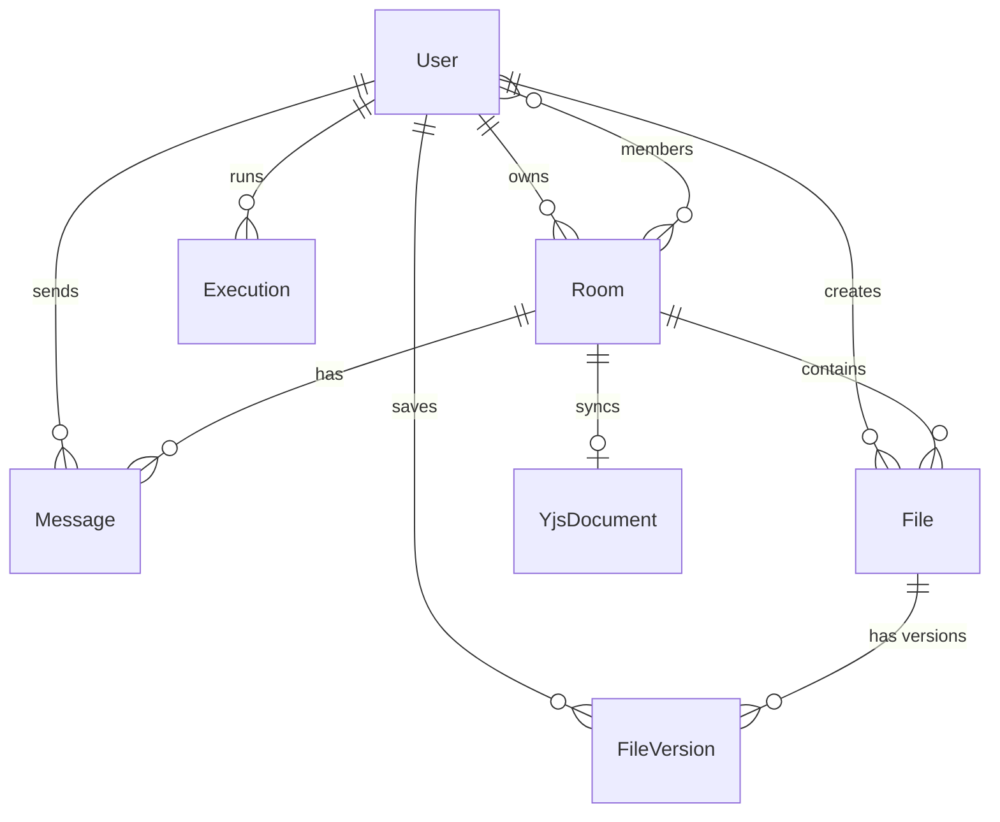

# CodeSync — Database Design

## Overview

CodeSync uses MongoDB with Mongoose ODM. All collections share a single database (`codesync` by default).

## Entity Relationship Diagram



## Schemas

### User
```javascript
{
  name:         String,    // 2-50 chars, required
  email:        String,    // unique index, lowercase, required
  passwordHash: String,    // bcrypt hash, required, never returned in queries
  avatarColor:  String,    // hex color for avatar circle
  createdAt:    Date,
  updatedAt:    Date
}
```
**Indexes:** `{ email: 1 }` (unique)

### Room
```javascript
{
  name:       String,     // 1-100 chars, required
  ownerId:    ObjectId,   // ref: User, required
  members: [{
    userId:   ObjectId,   // ref: User
    role:     String,     // enum: 'owner', 'editor', 'viewer'
    joinedAt: Date
  }],
  invitations: [{
    tokenHash:  String,   // SHA-256 hash of the invitation token
    createdBy:  ObjectId, // ref: User
    expiresAt:  Date,
    revoked:    Boolean,
    createdAt:  Date
  }],
  language:   String,     // default language for new files
  createdAt:  Date,
  updatedAt:  Date
}
```
**Indexes:** `{ 'members.userId': 1 }`, `{ ownerId: 1 }`

### File
```javascript
{
  roomId:    ObjectId,    // ref: Room, required
  filename:  String,      // 1-100 chars, required
  language:  String,      // enum of supported languages
  creatorId: ObjectId,    // ref: User
  content:   String,      // last saved content
  createdAt: Date,
  updatedAt: Date
}
```
**Indexes:** `{ roomId: 1, filename: 1 }` (compound unique)

### FileVersion
```javascript
{
  fileId:        ObjectId,  // ref: File, required
  roomId:        ObjectId,  // ref: Room, required
  savedBy:       ObjectId,  // ref: User, required
  content:       String,    // snapshot content
  versionNumber: Number,    // auto-incremented per file
  message:       String,    // optional save message
  createdAt:     Date
}
```
**Indexes:** `{ fileId: 1, createdAt: -1 }`, `{ fileId: 1, versionNumber: 1 }`

### Message
```javascript
{
  roomId:    ObjectId,    // ref: Room, required
  senderId:  ObjectId,    // ref: User, required
  content:   String,      // 1-2000 chars, required
  createdAt: Date
}
```
**Indexes:** `{ roomId: 1, createdAt: 1 }`

### Execution
```javascript
{
  userId:        ObjectId,  // ref: User, required
  roomId:        ObjectId,  // ref: Room
  fileId:        ObjectId,  // ref: File
  language:      String,    // required
  code:          String,    // submitted code (limited retention)
  status:        String,    // enum: 'pending', 'running', 'completed', 'failed', 'timeout'
  output:        String,    // stdout (truncated to 1MB)
  error:         String,    // stderr
  executionTime: Number,    // milliseconds
  createdAt:     Date
}
```
**Indexes:** `{ userId: 1, createdAt: -1 }`

### YjsDocument (Collaboration Server)
```javascript
{
  docName:   String,      // unique, format: 'room:{roomId}:file:{fileId}'
  updates:   [Buffer],    // array of binary Yjs updates
  snapshot:  Buffer,       // merged Yjs state
  updatedAt: Date
}
```
**Indexes:** `{ docName: 1 }` (unique)

## Yjs Persistence Strategy

The collaboration server persists Yjs document state using a compaction strategy:

1. **Incremental updates**: Each Yjs update (binary) is appended to the `updates` array
2. **Compaction threshold**: When `updates` exceeds 50 entries, all updates + snapshot are merged using `Y.mergeUpdates()`
3. **Merged snapshot**: The result replaces the `snapshot` field and `updates` is cleared
4. **Document recovery**: On server restart, apply `snapshot` first, then all pending `updates`

This prevents unbounded storage growth while preserving full CRDT state.

## Important Notes

- **passwordHash** is excluded from all User query results by default (`select: false`)
- **Invitation tokens** are stored as SHA-256 hashes; the plaintext token is returned only at creation time
- **File content** in the File schema represents the last explicitly saved state, separate from the live Yjs document state
- **FileVersion content** is a point-in-time snapshot, not a diff
- **Message** documents are not modified after creation (append-only)
- **Execution code** field should have a retention policy in production to limit storage

## Query Patterns and Indexes

| Query Pattern | Index Used |
|--------------|------------|
| Find user by email | `users.email` (unique) |
| Find rooms for a user | `rooms.members.userId` |
| Find files in a room | `files.roomId + filename` (compound) |
| Find versions for a file | `fileversions.fileId + createdAt` |
| Find messages in a room | `messages.roomId + createdAt` |
| Find Yjs document | `yjsdocuments.docName` (unique) |
| Find user's executions | `executions.userId + createdAt` |
